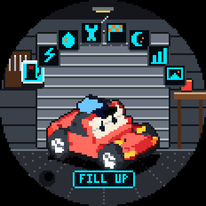
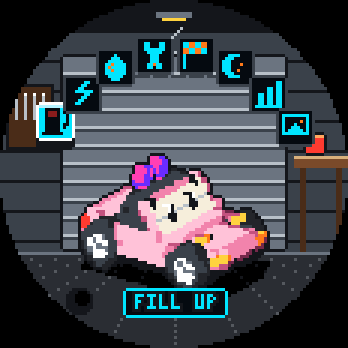
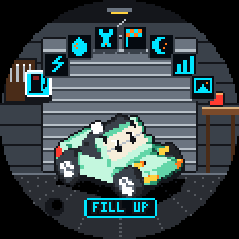
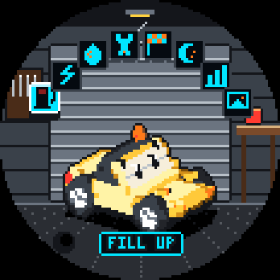
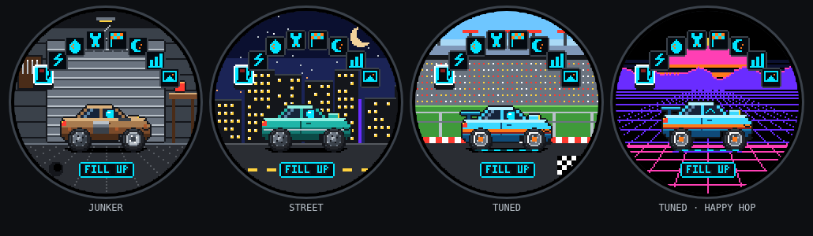
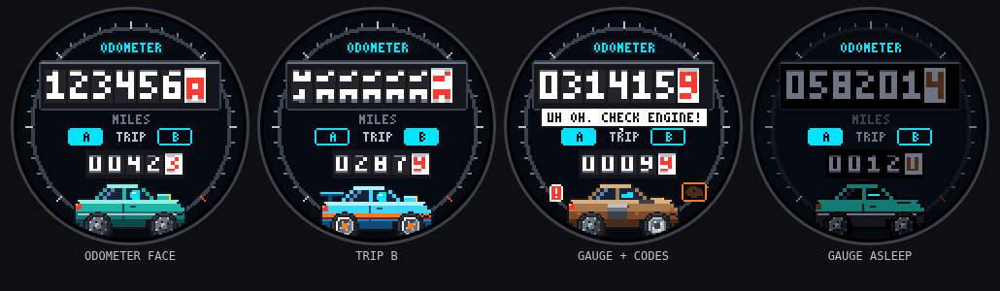
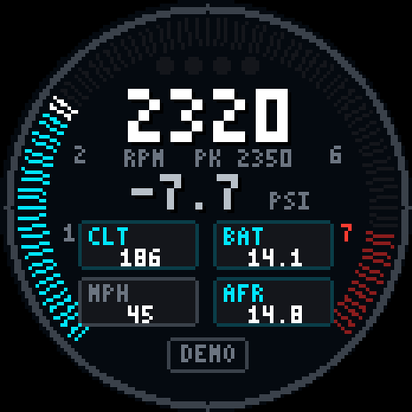
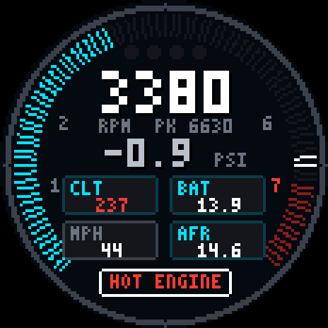
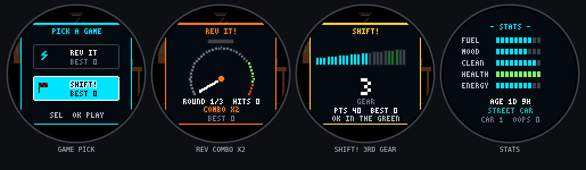

# Gaugie demo

Built, self-contained demo pages for Gaugie, a dashboard-gauge car pet named Blippy. These are build outputs only; the source code is not in this repo.

- [Hub app (demo mode)](https://darceknight.github.io/gaugie-demo/): virtual Gaugie, pet tab, odometer face, check-engine demo, GAUGE tab (pro gauges + simulated OBD2 feed)
- [Pet simulator](https://darceknight.github.io/gaugie-demo/tama.html)

## Meet the cast

Tap the car for a happy bounce, drag it to spin it through every angle, and pick a character in the Pet tab or the simulator.

| BLIPPY | SAKU | MINT | SUNNY |
|---|---|---|---|
|  |  |  |  |

[Full sprite sheet](img/blippy-cast-sheet.png)

Pro gauge mode (demo drive, and a hot-engine warning): shift light, peak hold, boost, coolant, battery, speed, AFR.

 

